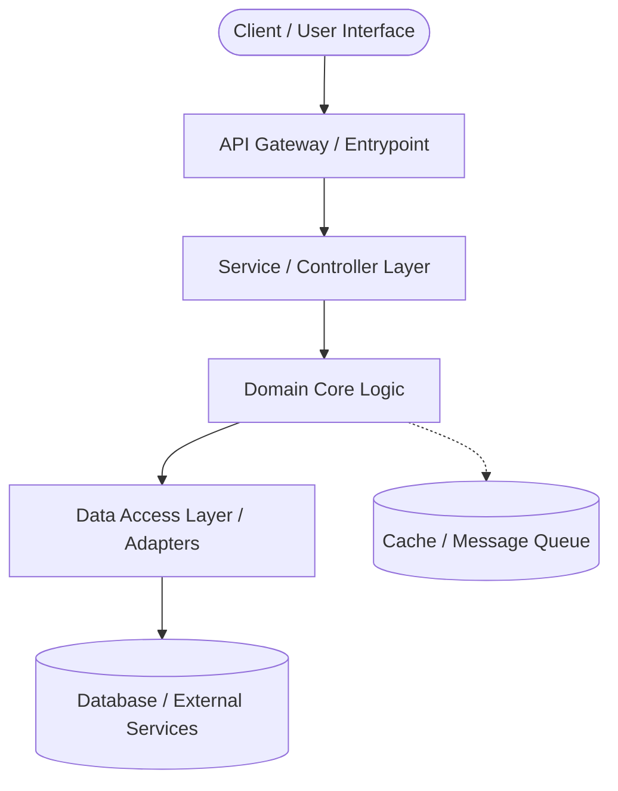

# System Architecture Documentation

## 1. Overview & Vision
This document outlines the high-level architecture, design decisions, and system constraints for the project. It serves as the single source of truth for the system's structural patterns, component interactions, and technical roadmap.

### 1.1 Objectives & Core Goals
- **Modularity:** Maintain clean boundaries between business domains and infrastructure concerns.
- **Scalability & Performance:** Ensure low latency, predictable resource consumption, and horizontal scaling capabilities.
- **Maintainability & Extensibility:** Support easy addition of new features without cascading refactoring.
- **Observability & Security:** Built-in logging, metric tracking, and least-privilege security controls.

---

## 2. Architecture Patterns & Design Philosophy



### 2.1 Core Architectural Principles
1. **Separation of Concerns:** Business logic is decoupled from network protocols, external storage, and presentation layers.
2. **Configuration-Driven:** Environments (Development, Staging, Production) are driven by validated environment variables and configuration files.
3. **Idempotence & Fault Tolerance:** Failure modes are anticipated; operations that modify state handle network retries gracefully.

---

## 3. High-Level Component Breakdown

| Layer / Component | Description | Responsibilities |
| :--- | :--- | :--- |
| **Presentation / Interface** | User-facing application or API consumer | Input capture, UI state management, rendering |
| **API Gateway / Routing** | Transport protocol handling (REST / GraphQL / gRPC) | Request validation, authentication, rate limiting |
| **Domain Services** | Pure business logic engine | Rule enforcement, domain transformations, workflows |
| **Infrastructure / Persistence** | Storage, messaging, and third-party APIs | Database transactions, external service integration |

---

## 4. Directory Structure (Proposed)

```text
.
├── src/
│   ├── config/          # Environment & application configurations
│   ├── core/            # Domain models, business logic & interfaces
│   ├── modules/         # Feature modules / domain services
│   ├── infrastructure/  # DB connectors, external API clients, storage
│   └── utils/           # Shared helper functions and common utilities
├── docs/                # Extended documentation and specifications
├── tests/               # Unit, integration, and end-to-end tests
├── .env.example         # Template for environment configuration
├── ARCHITECTURE.md      # This file
├── README.md            # Project overview and getting started guide
└── .gitignore           # Git ignore rules
```

---

## 5. Security & Compliance
- **Authentication & Authorization:** Secure token-based session handling / RBAC.
- **Secrets Management:** Secrets and keys are never committed to version control (`.gitignore` + environment injection).
- **Data Protection:** Sanitization of all inputs and encryption in transit (TLS) and at rest.

---

## 6. Next Steps & Evolution Plan
1. [ ] Finalize technology stack selections (Runtime, Database, Framework).
2. [ ] Define API schemas and contracts.
3. [ ] Configure local containerization / dev environment.
4. [ ] Setup automated CI/CD pipeline and code quality checks.
