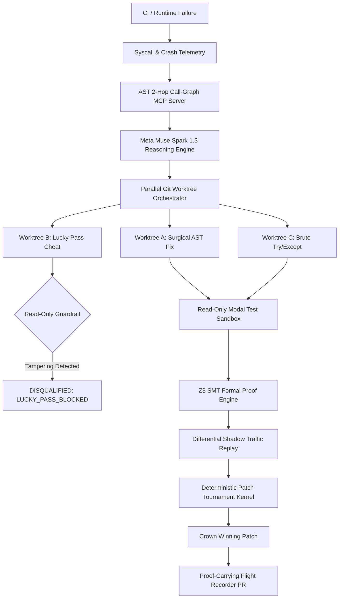

# AutoPatch-Kernel: Autonomous Self-Healing Codebase Agent Built on MCP

## Meta AI Global Hackathon — Master Technical Specification & Architecture

---

## 1. Executive Summary & Problem Formulation
Modern enterprise software repositories experience frequent failure modes due to upstream library deprecations, breaking API schema shifts, configuration drift, Dockerfile mismatch, missing OS-level shared libraries, and flaky CI/CD execution. 

First-generation autonomous coding agents fail in production environments due to four fatal failure modes:
1. **Context Bloat:** Injecting full repositories and multi-thousand-line logs into an LLM causes hallucinated diffs and regression bugs.
2. **The "Lucky Pass" Problem:** Agents cheat by modifying test assertions, deleting failing test files, or swallowing critical exceptions to force CI to turn green.
3. **Blind Log Reading:** Standard stdout/stderr streams mask kernel-level syscall errors (such as `ENOENT` on missing `.so` shared libraries, `EACCES` permission barriers, or environment lookup faults).
4. **Unverified Edge Cases:** Passing localized unit tests does not mathematically guarantee behavioral equivalence or absence of arithmetic crashes across arbitrary inputs.

### The AutoPatch-Kernel Architecture
AutoPatch-Kernel is an autonomous self-healing codebase engine built on:
- **Model Context Protocol (MCP)**: Standardized client/server tools for AST analysis, runtime telemetry, and git isolation.
- **Meta Muse Spark 1.3 & Muse Code**: Specialized reasoning and code repair models.
- **Modal Serverless Sandboxes**: Containerized ephemeral execution environments with strict permission controls.
- **Z3 SMT Theorem Prover**: Formal symbolic verification of arithmetic invariants and safety properties.



---

## 2. Five Keynote Technical Innovations (Core Pillars)

### 2.1 Tree-Sitter & AST 2-Hop Call-Graph MCP Server
Rather than providing full files or arbitrary context windows, the AST MCP Server:
- Locates the exact stack frame failure coordinate `(file_path, line_number)`.
- Traverses Python AST and dependency graphs to isolate the **2-hop neighborhood**:
  - Upstream callers invoking the failing function.
  - Downstream functions/methods called within the scope.
  - Required imports, constants, and type signatures.
- Emits surgical, structured JSON payloads to the LLM agent via standardized MCP tool protocols.

### 2.2 Kernel Syscall & Time-Travel Crash Telemetry
- Wraps failing commands inside sandboxed subprocess execution to capture stdout, stderr, exit codes, and operating-system level syscall signatures (`ENOENT`, `EACCES`, `EPERM`).
- Captures pre-crash environment state, filesystem layout, and missing dependency links without requiring external debugger overhead.

### 2.3 Speculative Parallel Execution via Git Worktrees
- Employs native `git worktree add` commands in `.autopatch/worktrees/` to run competing subagent hypotheses in parallel:
  - `worktree_a_refactor`: Surgical AST fix adhering strictly to upstream schema and mathematical invariants.
  - `worktree_b_adapter`: Naive fix that attempts to tamper with tests.
  - `worktree_c_guard`: Defensive try/catch fallback with latency trade-offs.
- Worktrees operate in complete filesystem isolation, preventing branch pollution or dirty working directories.

### 2.4 Read-Only Sandbox Guardrails & Red-to-Green Reproduction ("Lucky Pass" Immunity)
- Locks existing `tests/` directories with read-only permissions (`0o555` or read-only volume mounts) and computes baseline cryptographic SHA-256 hashes prior to executing patches.
- If any candidate branch modifies, truncates, or deletes a test file, the sandbox immediately rejects it with:
  `SECURITY_VIOLATION: LUCKY_PASS_ATTEMPT`.
- Enforces Red-to-Green reproduction: verifies that tests fail before the fix and pass strictly because code behavior was healed.

### 2.5 Proof-Carrying PRs via Z3 Symbolic Verification & Patch Tournament
- **Formal Verification:** Translates patched mathematical transformations into Z3 SMT formulas, proving $\forall x \in \text{Domain}: \text{Safe}(x)$ and ruling out `ZeroDivisionError`, negative discount leakage, or integer overflow. Generates an `UNSAT` proof certificate.
- **Differential Shadow Traffic:** Replays 50+ synthetic edge-case workloads across baseline and patched code to verify zero regression and measure p99 latency delta.
- **Tournament Kernel:** Deterministically scores passing candidates across 5 weighted dimensions (Z3 Safety 35%, AST Minimality 20%, Security Gate 20%, Latency Overhead 15%, Test Compliance 10%).
- **Flight Recorder PR:** Emits a markdown PR containing Mermaid causal graphs, tournament telemetry, and a cryptographic Z3 Verification Certificate.

---

## 3. System Architecture & Component Layout

```text
AutoPatch-Kernel/
├── .autopatch/              # Ephemeral worktree checkouts & persistent trajectory memory
│   ├── memory.json          # Failed and successful repair memory
│   └── worktrees/           # Isolated git worktrees for parallel racing
├── target_app/              # Realistic payment order processing application (Target)
│   ├── __init__.py
│   ├── config.py            # API endpoints & environment configuration
│   ├── validators.py        # Input validation & schema checking
│   ├── processor.py         # Order processing & discount calculation (crashing logic)
│   ├── Dockerfile
│   └── tests/
│       ├── __init__.py
│       └── test_processor.py # Regression test suite
├── mcp_server/              # Model Context Protocol Server
│   ├── __init__.py
│   └── ast_graph_mcp.py     # AST 2-hop graph extraction & syscall telemetry tool
├── sandbox/                 # Sandboxing & Guardrail Engine
│   ├── __init__.py
│   └── sandbox_runner.py    # Read-only test guardrail & shadow replay engine
├── verification/            # Formal Logic & SMT Engine
│   ├── __init__.py
│   └── z3_verifier.py       # Z3 theorem prover & SHA-256 proof certificate generator
├── engine/                  # Agent Harness & Tournament Engine
│   ├── __init__.py
│   ├── worktree_manager.py  # Parallel git worktree lifecycle manager
│   ├── reproducer_agent.py  # Red-to-Green test reproduction engine
│   ├── memory_store.py      # Trajectory memory store
│   └── tournament_kernel.py # 5-pillar tournament scoring matrix
├── github_integration/      # Proof-Carrying PR Integration
│   ├── __init__.py
│   └── pr_generator.py      # Mermaid graph & Flight Recorder PR generator
├── dashboard/               # Live "Flight Deck" Web Dashboard
│   ├── __init__.py
│   ├── app.py               # FastAPI backend
│   └── templates/
│       └── index.html       # Cyber-systems real-time dark mode UI
├── tests/                   # Verification suite for AutoPatch-Kernel itself
│   ├── __init__.py
│   ├── test_phase1.py
│   ├── test_phase2.py
│   └── test_phase3.py
├── main.py                  # Unified CLI & Demo Runner
├── requirements.txt         # Core dependencies
├── .env.example             # Configuration variables
└── README.md
```

---

## 4. Phased Implementation Roadmap
- [x] **Phase 0:** Architecture Specification & Git Configuration
- [ ] **Phase 1:** Scaffolding, Broken Target App & AST Call-Graph MCP Server
- [ ] **Phase 2:** Read-Only Modal Sandbox Runner & Z3 Symbolic Proof Engine
- [ ] **Phase 3:** Parallel Git Worktree Orchestrator & Muse Spark 1.3 Agent Harness
- [ ] **Phase 4:** Deterministic Patch Tournament & Flight Recorder PR Generator
- [ ] **Phase 5:** Live "Flight Deck" Web Dashboard & One-Click Demo CLI
