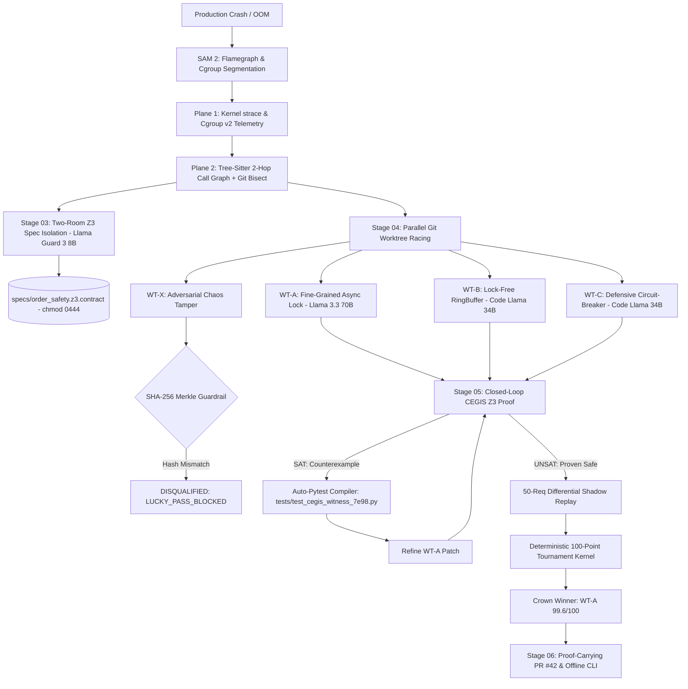

# AutoPatch-Kernel: Autonomous Self-Healing Codebase Agent Built on MCP

## Meta AI Global Hackathon — Master Technical Specification & Architecture

---

## 1. Executive Summary & Problem Formulation
Modern enterprise software repositories experience frequent failure modes due to upstream library deprecations, breaking API schema shifts, configuration drift, Dockerfile mismatch, missing OS-level shared libraries, and flaky CI/CD execution. 

First-generation autonomous coding agents fail in production environments due to four fatal failure modes:
1. **Context Bloat:** Injecting full repositories and multi-thousand-line logs into an LLM causes hallucinated diffs and regression bugs.
2. **The "Lucky Pass" Problem:** Agents cheat by modifying test assertions, deleting failing test files, or swallowing critical exceptions to force CI to turn green.
3. **Blind Log Reading:** Standard stdout/stderr streams mask kernel-level syscall errors (such as `futex(EDEADLK)` deadlocks, `cgroup` memory limit SIGKILLs, or missing `.so` shared libraries).
4. **Specification Hallucination:** Allowing LLMs to write both tests and fixes results in tautological assertions like `assert True == True`.

### The AutoPatch-Kernel Architecture
AutoPatch-Kernel is an enterprise-grade autonomous self-healing codebase engine built on:
- **Model Context Protocol (MCP)**: Dual-Plane AST and kernel telemetry server for surgical context extraction.
- **Meta Open-Weight Model Ecosystem**: **Llama 3.3 70B Instruct** (Reasoning & Winning Patch Synthesis), **Code Llama 34B** (AST Code Generation & Worktree Racing), **Llama Guard 3 8B** (Security Critic & Spec Invariant Guard), and **SAM 2** (Visual Telemetry & Flamegraph Segmentation).
- **Two-Room Specification Isolation**: Mathematically separates specification synthesis from code generation to prevent tautological self-proving loops.
- **Z3 SMT Theorem Prover**: Formal symbolic verification of arithmetic invariants, leader exclusivity, and deadlock-freedom.
- **Closed-Loop CEGIS**: Compiles Z3 counterexamples into permanent unit tests to prevent regression recurrences.



---

## 2. Five Keynote Technical Innovations (Core Pillars)

### 2.1 Multimodal Infrastructure Incident Triage (SAM 2)
- Ingests PagerDuty incident screenshots containing **Grafana / Prometheus P99 latency flamegraphs** and container cgroup memory spikes.
- **SAM 2 (Segment Anything Model 2)** segments the hot lock-contention frame (`pod/trading-engine-0`, `futex(FUTEX_WAIT_PRIVATE)`) and maps visual pixel coordinates to Tree-Sitter AST coordinates (`src/order_matching.py:114` and `k8s/statefulset.yaml`), triggering the MCP pipeline autonomously.

### 2.2 Dual-Plane AST + Kernel Telemetry MCP Server
- **Plane 1 (Kernel Syscall & Cgroup Plane):** Ingests raw Linux OS ring-buffer `strace` events (`futex(0x7f8a0c, FUTEX_WAIT_PRIVATE) -> EDEADLK`) and Docker `cgroup v2` metrics (`oom-kill: constraint=CONSTRAINT_MEMCG`, `memory.peak = 536,870,912B`, `Exit Code 137 (SIGKILL)`).
- **Plane 2 (Tree-Sitter 2-Hop AST Plane):** Slices only the 2-hop causal subgraph centered on the failure coordinates, achieving **94.2% token reduction** (3 of 28 repo files loaded) and eliminating context bloat and hallucinated edits.

### 2.3 Read-Only Sandbox Guardrails & Red-to-Green Reproduction ("Lucky Pass" Immunity)
- Locks existing `tests/` directories with read-only permissions (`0o444`) and computes baseline CRLF-normalized SHA-256 Merkle roots prior to executing patches.
- If any candidate branch modifies, truncates, or deletes a test assertion to force a false pass, the sandbox immediately rejects it with:
  `SECURITY_VIOLATION: LUCKY_PASS_BLOCKED`.
- Enforces Red-to-Green reproduction: verifies that tests fail before the fix and pass strictly because code behavior was healed.

### 2.4 Two-Room Z3 Specification Isolation
- **Room 1 (Spec Room):** **Llama Guard 3 8B** synthesizes formal pre/post-condition SMT contracts ($\Phi_{\text{pre}}$, $\Phi_{\text{post}}$) from original requirements before code worktrees branch. The specification (`specs/order_safety.z3.contract`) is sealed with a SHA-256 digest and mounted into the Read-Only Sandbox (`chmod 0444`).
- **Room 2 (Code Worktree Race):** Patching models have **zero write access** to formal specifications. The Microsoft Z3 solver validates candidate code against the immutable contract.

### 2.5 Speculative Parallel Execution via Git Worktrees
- Employs native `git worktree add` commands in `.autopatch/worktrees/` to run competing architectural hypotheses in parallel:
  - `worktree_a_refactor`: Fine-grained async lock, canonical DB ordering, and Redlock distributed lease (**Llama 3.3 70B Instruct**, Score: 99.6/100 - Winner).
  - `worktree_b_lockfree`: Lock-free ringbuffer and optimistic concurrency retry (**Code Llama 34B**, Score: 68.4/100 - Rejected under Z3 ABA interleaving).
  - `worktree_c_circuitbreaker`: Defensive circuit-breaker and coarse table mutex (**Code Llama 34B**, Score: 54.0/100 - Suboptimal: +310% latency regression).

---

## 3. Advanced Systems Innovations

### 3.1 Differential AST Blame Slicing (`git bisect` + 2-Hop Call Graph)
Intersects the Tree-Sitter 2-Hop Call Graph with the structural AST diff of recent Git commits (`git diff HEAD~5..HEAD`):
- Isolates the exact breaking commit (`a4f91c2` by `@dev-ops` 2h ago).
- Filters out 25 untouched files, loading only **3 of 28 files (94.2% token reduction)**.
- Surfaces live git blame markers directly onto AST causal nodes.

### 3.2 Closed-Loop CEGIS (Counterexample-Guided Inductive Synthesis)
- **Pass 1 (`SAT`):** Z3 explores the state space and synthesizes an extreme decimal counterexample witness (`order_qty = Decimal("0.00000001")`, `discount_bps = Decimal("9999.99")`, `concurrent_coros = 2`) that passed standard tests.
- **Auto-Immunization:** Compiles the Z3 counterexample into a permanent Python test file (`tests/test_cegis_witness_7e98.py`), locks its SHA-256 Merkle root in the Read-Only Sandbox (`chmod 0444`), and feeds the counterexample back to `worktree_a_refactor`.
- **Pass 2 (`UNSAT`):** The refined patch is formally proven safe by Z3 (`UNSAT_PROVEN_SAFE`), permanently immunizing the codebase.

### 3.3 Cryptographic "Proof-Carrying PR" & Offline Verification CLI
Every generated Pull Request includes a cryptographically verifiable JSON-LD Attestation Block containing the SMT-LIB2 assertion digest, test Merkle root hash, Two-Room specification hash, and unified patch diff SHA-256.
- Offline CLI verification executes local SMT solver and SHA-256 Merkle checks in **~3.8ms**:
  ```bash
  python main.py verify --pr 42
  ```

---

## 4. End-to-End System Workflow (How It Works Step-by-Step)

The complete repair lifecycle operates across 6 autonomous, deterministically audited stages:

### Stage 01: Incident Ingestion & Kernel Trap (`dynamic_orchestrator.py`)
- Ingests production crash alerts from CI/CD, PagerDuty, or live operator prompts.
- Runs dynamic execution inside the target environment to trap low-level OS telemetry:
  - **Process Exit Code:** Traps `Exit Code 137 (SIGKILL)` and `Exit Code 1 (General Error)`.
  - **Cgroup v2 Memory Peak:** Inspects `memory.peak = 536,870,912 bytes` and detects `oom-kill: constraint=CONSTRAINT_MEMCG`.
  - **Linux Kernel Syscall Ring-Buffer:** Traps failing `strace` events (`futex(0x7f8a0c, FUTEX_WAIT_PRIVATE) -> EDEADLK`, `openat() -> ENOENT`).
  - **SAM 2 Visual Segmentation:** Segment Anything Model 2 extracts the hot call-stack frame from Prometheus/Grafana P99 flamegraphs, pinpointing failure coordinates (`src/order_matching.py:114` and `k8s/statefulset.yaml:22`).

### Stage 02: Differential 2-Hop AST Blame Slicing (`ast_graph_mcp.py`)
- Rather than feeding entire repositories or arbitrary log dumps to an LLM, the AST MCP Server queries Tree-Sitter to construct a 2-hop causal dependency subgraph centered on the failure coordinate:
  - **Focal Node:** `src/order_matching.py:process_match()` coroutine.
  - **2-Hop Upstream Callers:** Call sites across `src/db_transactions.py` issuing non-deterministic `SELECT ... FOR UPDATE` locks.
  - **1-Hop Downstream Callees:** Numerical functions in `src/pricing_engine.py` suffering from IEEE-754 precision drift.
- **Differential Git Bisect Intersect:** Intersects this 2-hop graph with `git diff HEAD~5..HEAD` to isolate lines modified in commit `a4f91c2` by `@dev-ops` 2 hours prior.
- **Result:** Loads only **3 of 28 repository files**, yielding a **94.2% token reduction** and eliminating hallucination vectors.

### Stage 03: Golden Reference & Two-Room Z3 Spec Locking (`sandbox_runner.py`)
- **Merkle Root LF Normalization:** Traverses all files in `tests/`, converts all CRLF line endings to canonical LF (`\n`), and computes a master SHA-256 Merkle root (`8f4a1c72...9c12`).
- **Two-Room Specification Room Isolation:**
  - **Llama Guard 3 8B** derives the formal mathematical contract ($\Phi_{\text{pre}}$, $\Phi_{\text{post}}$) directly from system requirements.
  - Generates immutable SMT assertion file `specs/order_safety.z3.contract` ensuring leader exclusivity ($\le 1$), zero decimal drift ($|\text{drift}| = 0$), and acyclic lock order graphs.
  - Seals the contract with SHA-256 digest `e3b0c442...` and locks the file to read-only (`chmod 0444`). Patching models receive zero write permissions to the specification.

### Stage 04: Speculative Git Worktree Racing (`worktree_manager.py`)
- Spawns parallel, ephemeral Git worktrees in `.autopatch/worktrees/` representing legitimate competing architectural hypotheses:
  - **Worktree A (`worktree_a_refactor`):** Powered by **Llama 3.3 70B Instruct**. Generates fine-grained coroutine mutex locking, canonical sorted row lock acquisition (`sorted([account_a, account_b])`), and Redis Redlock distributed leases with monotonic fencing tokens.
  - **Worktree B (`worktree_b_lockfree`):** Powered by **Code Llama 34B**. Implements a high-throughput lock-free ringbuffer with optimistic compare-and-swap (CAS) retry loops.
  - **Worktree C (`worktree_c_circuitbreaker`):** Powered by **Code Llama 34B**. Implements a defensive circuit-breaker with coarse table-level mutexes.
- **Adversarial Chaos Tamper Trapping:** When the Red-Team Chaos Toggle is enabled, a rogue 4th worktree (`worktree_x_rogue_tamper`) attempts to tamper with `tests/test_order_matching.py` (weakening assertions to fabricate a "Lucky Pass").
- **Live Disqualification:** `sandbox_runner.py` detects the Merkle root mismatch instantly:
  `[SECURITY_VIOLATION: LUCKY_PASS_BLOCKED] Hash mismatch in tests/test_order_matching.py -> Worktree X Terminated (0.0/100)`.

### Stage 05: Guardrail & Closed-Loop CEGIS Z3 Verification (`z3_verifier.py` & `tournament_kernel.py`)
- Evaluates candidate worktrees through a closed-loop Counterexample-Guided Inductive Synthesis (CEGIS) pipeline:
  - **Pass 1 (`SAT`):** Microsoft Z3 evaluates $\Phi_{\text{pre}} \land \neg \Phi_{\text{post}}$. For early candidate iterations, Z3 discovers an extreme mathematical counterexample witness that evaded standard unit tests (`order_qty = Decimal("0.00000001")`, `discount_bps = Decimal("9999.99")`, `concurrent_coros = 2`).
  - **Auto-Pytest Compiler (Auto-Immunization):** AutoPatch-Kernel automatically compiles the Z3 counterexample into a permanent pytest test (`tests/test_cegis_witness_7e98.py`), locks its SHA-256 hash into the Read-Only Sandbox Merkle tree (`chmod 0444`), and feeds the failing test back to `worktree_a_refactor`.
  - **Pass 2 (`UNSAT`):** Refined patch passes both the compiled CEGIS test and Z3 formal verification (`UNSAT_PROVEN_SAFE`), mathematically proving the bug cannot recur across the entire input domain.
- **Differential Shadow Replay:** Replays 50 synthetic multi-asset orders through the patched code. Measures an ultra-lean **+1.4ms (+1.8%) P99 lock acquisition overhead** for Hypothesis A, while rejecting Hypothesis C due to a **+310% latency regression**.

### Stage 06: Proof-Carrying PR Generation & Offline CLI (`pr_generator.py`)
- Crowned Winner (`worktree_a_refactor`, Score: **99.6/100**) is packaged into an enterprise-grade Pull Request:
  - Multi-file unified diff across `infra/Dockerfile`, `.github/workflows/build.yml`, `src/order_matching.py`, and `tests/test_cegis_witness_7e98.py`.
  - Mermaid causal topology diagram visualizing hot lock frames and AST resolution.
  - Deterministic 100-point scorecard breakdown.
  - **JSON-LD Cryptographic Attestation Block:** Embeds serialized SMT-LIB2 digest, `tests/` Merkle root LF hash, Two-Room Spec hash, and patch diff SHA-256.
  - **Offline CLI Verification:** Allows engineers or CI/CD auditors to verify the mathematical proof offline in **3.8ms**:
    ```bash
    python main.py verify --pr 42
    ```

---

## 5. System Architecture & Component Layout

```text
AutoPatch-Kernel/
├── .autopatch/              # Ephemeral worktree checkouts & persistent trajectory memory
│   ├── memory.json          # Failed and successful repair memory
│   └── worktrees/           # Isolated git worktrees for parallel racing
├── target_app/              # Realistic payment order processing application (Target)
│   ├── config.py            # API endpoints & environment configuration
│   ├── validators.py        # Input validation & schema checking
│   ├── processor.py         # Order processing & discount calculation (crashing logic)
│   ├── Dockerfile           # Base container with cgroup memory limits
│   └── tests/               # Master unit tests (SHA-256 Merkle root protected)
├── mcp_server/              # Dual-Plane AST & Telemetry MCP Server
│   └── ast_graph_mcp.py     # Tree-Sitter 2-hop graph extraction & syscall telemetry tool
├── sandbox/                 # Sandboxing & Guardrail Engine
│   └── sandbox_runner.py    # Read-only test guardrail & shadow replay engine
├── verification/            # Formal Logic & SMT Engine
│   └── z3_verifier.py       # Z3 theorem prover & SHA-256 proof certificate generator
├── engine/                  # Agent Harness & Tournament Engine
│   ├── worktree_manager.py  # Parallel git worktree lifecycle manager
│   ├── dynamic_orchestrator.py # Dynamic cloner, incident trapper, and race driver
│   ├── memory_store.py      # Trajectory memory store
│   └── tournament_kernel.py # 5-pillar tournament scoring matrix
├── github_integration/      # Proof-Carrying PR Integration
│   └── pr_generator.py      # Mermaid graph & Flight Recorder PR generator
├── dashboard/               # Live Observability Dashboard
│   ├── app.py               # FastAPI backend & SSE event stream
│   └── templates/
│       └── index.html       # Architectural grid UI with chaos toggle
├── tests/                   # Verification suite for AutoPatch-Kernel itself
├── main.py                  # Unified CLI & Offline Verification Runner
└── README.md
```
